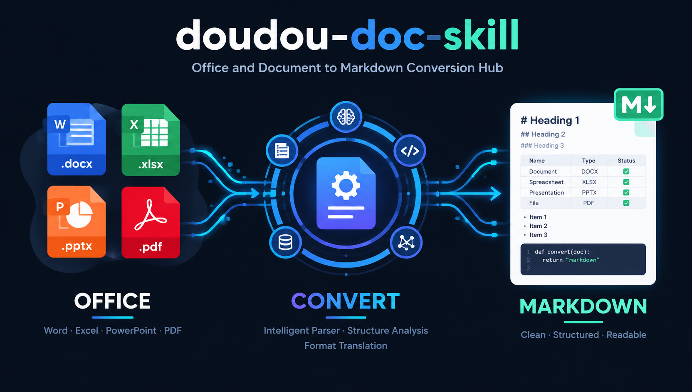

<h1 align="center">doudou-doc-skill</h1>

<p align="center">
  <a href="README.md">简体中文</a> | <b>English</b>
</p>

<p align="center">
  Efficient tool for converting Office documents, PDFs, and eBooks to Markdown.<br>
  Supports <b>Word (<code>doc</code>/<code>docx</code>/<code>odt</code>/<code>rtf</code>)</b>, <b>PPT (<code>ppt</code>/<code>pptx</code>/<code>odp</code>)</b>, <b>Spreadsheets (<code>xlsx</code>/<code>ods</code>/<code>csv</code>)</b>, <b><code>PDF</code></b>, and <b><code>EPUB</code></b>, featuring fast plain text and table extraction for <b>local files, directory batch processing, and remote URLs</b>.
</p>

<p align="center">
  
</p>

---

## 📑 Table of Contents

- [📖 Skill User Guide](#-skill-user-guide)
  - [1. Installation](#1-installation)
  - [2. Usage](#2-usage)
- [⚙️ API Configuration](#️-api-configuration)
- [💬 Community & Support](#-community--support)
- [📄 License](#-license)

---

## 📖 Skill User Guide

This skill library serves as an **AI Agent assistant for document-to-Markdown extraction** (natively supports Antigravity, Claude Code, OpenCode, and other platforms).

---

### 1. Installation

Install in any target project root directory with one command:

```bash
npx skills add undsky/doudou-doc-skill --yes
```

---

### 2. Usage

Simply instruct the AI in plain language to convert documents, process directories in batch, or parse remote document links:

```text
Help me convert this Product Requirement Document to Markdown format: ./resources/data/prd.docx
```

Or batch convert all contracts and reports in a directory into Markdown:

```text
Batch convert all documents in this directory to Markdown: ./resources/data/contracts/
```

Or parse a remote online document and extract the body text:

```text
Read this online technical whitepaper and extract plain text Markdown: https://example.com/whitepaper.pdf
```

---

## ⚙️ API Configuration

Rename `.env.example` to `.env` and place it in the skill or project root directory:

```ini
# https://ai.undsky.com/ai/agent Log in and click profile avatar -> Profile to get UUID
DOUDOU_API_KEY=your_uuid_here
DOUDOU_API_URL=https://n8n.undsky.com
```

---

## 💬 Community & Support

|               Official Account               |             QQ Group (1095058701)             |
| :------------------------------------------: | :-------------------------------------------: |
|  |  |

---

## 📄 License

This project is licensed under the [CC BY-NC 4.0](LICENSE) License.

- Free for personal use, learning, research, and non-commercial projects.
- When publishing derivative works publicly, please attribute the source.
- Commercial use requires separate authorization; please contact the author.
