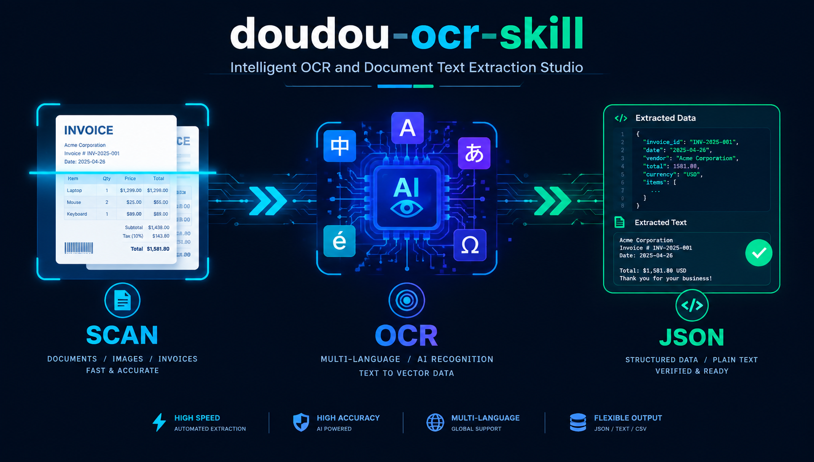

<h1 align="center">doudou-ocr-skill</h1>

<p align="center">
  <b>简体中文</b> | <a href="README_EN.md">English</a>
</p>

<p align="center">
  基于高精度 OCR 引擎与 PDF 智能文本抽取工具。<br>
  支持<b>截图取字</b>、<b>扫描件/拍照文档识别</b>、<b>双层 PDF 原文极速直抽</b>与 <b>中/英/日/法/德等 10 种语言文字提取</b>，支持 <b>TXT 纯文本与 JSON 结构化格式导出</b>。
</p>

<p align="center">
  
</p>

---

## 📑 目录导航

- [📖 技能使用指南](#-技能使用指南)
  - [一、安装](#一安装)
  - [二、使用](#二使用)
- [⚙️ 接口配置](#️-接口配置)
- [💬 交流与支持](#-交流与支持)
- [📄 许可证](#-许可证)

---

## 📖 技能使用指南

本技能库作为 **AI Agent 的图片与 PDF 文字识别（OCR）助手**（原生支持 Antigravity、Claude Code、OpenCode 等平台）。

---

### 一、安装

在任何目标工程根目录下，通过命令行一键安装：

```bash
npx skills add undsky/doudou-ocr-skill --yes
```

---

### 二、使用

```text
帮我识别这张发票图片中的所有文字内容：./resources/data/invoice.png
```

或者提取扫描件/翻拍 PDF 文档的文字：

```text
提取这份扫描合同 PDF 的全文内容：./resources/data/scanned_contract.pdf
```

或者多语言识别（如日文、英文材料）：

```text
识别这张日文说明书截图并提取文本：./resources/data/manual_jp.jpg
```

---

## ⚙️ 接口配置

将 `.env.example` 重命名为 `.env` 放到技能或项目根目录下

```ini
# https://ai.undsky.com/ai/agent 登录后点击头像 -> 个人信息获取
DOUDOU_API_KEY=你的UUID
DOUDOU_API_URL=https://n8n.undsky.com
```

---

## 💬 交流与支持

|                    公众号                    |              QQ群（1095058701）               |
| :------------------------------------------: | :-------------------------------------------: |
|  |  |

---

## 📄 许可证

本项目采用 [CC BY-NC 4.0](LICENSE) 许可证。

- 个人使用、学习、研究与非商业项目可以直接使用。
- 公开发布衍生作品时，请注明来源。
- 商业用途需要单独授权，请联系作者。
