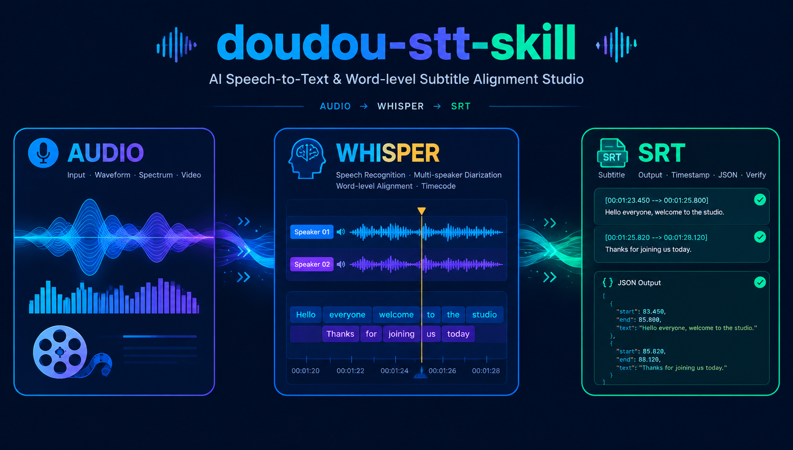

<h1 align="center">doudou-stt-skill</h1>

<p align="center">
  <a href="README.md">简体中文</a> | <b>English</b>
</p>

<p align="center">
  Audio & video transcription and subtitle generation tool powered by WhisperX / faster-whisper.<br>
  Supports <b>phoneme-level forced-alignment word-level timestamps</b>, <b>multi-speaker diarization</b>, and <b>full format export (SRT / VTT / TXT / TSV / JSON)</b>.
</p>

<p align="center">
  
</p>

---

## 📑 Table of Contents

- [📖 Skill User Guide](#-skill-user-guide)
  - [1. Installation](#1-installation)
  - [2. Usage](#2-usage)
- [⚙️ API Configuration](#️-api-configuration)
- [💬 Community & Support](#-community--support)
- [📄 License](#-license)

---

## 📖 Skill User Guide

This skill library serves as an **AI Agent assistant for audio/video transcription and verbatim extraction** (natively supports Antigravity, Claude Code, OpenCode, and other platforms).

---

### 1. Installation

Install in any target project root directory with one command:

```bash
npx skills add undsky/doudou-stt-skill --yes
```

---

### 2. Usage

Simply instruct the AI in plain language about which audio/video file to transcribe, what format to output, or whether to separate speakers:

```text
Transcribe this interview recording to Chinese SRT subtitles and differentiate speaker roles: ./resources/data/interview.mp4
```

Or extract the complete text for LLM summarization and reading:

```text
Extract this meeting recording as a plain text verbatim transcript: ./resources/data/meeting.m4a
```

---

## ⚙️ API Configuration

Rename `.env.example` to `.env` and place it in the skill or project root directory:

```ini
# https://ai.undsky.com/ai/agent Log in and click profile avatar -> Profile to get UUID
DOUDOU_API_KEY=your_uuid_here
DOUDOU_API_URL=https://n8n.undsky.com
```

---

## 💬 Community & Support

|               Official Account               |             QQ Group (1095058701)             |
| :------------------------------------------: | :-------------------------------------------: |
|  |  |

---

## 📄 License

This project is licensed under the [CC BY-NC 4.0](LICENSE) License.

- Free for personal use, learning, research, and non-commercial projects.
- When publishing derivative works publicly, please attribute the source.
- Commercial use requires separate authorization; please contact the author.
