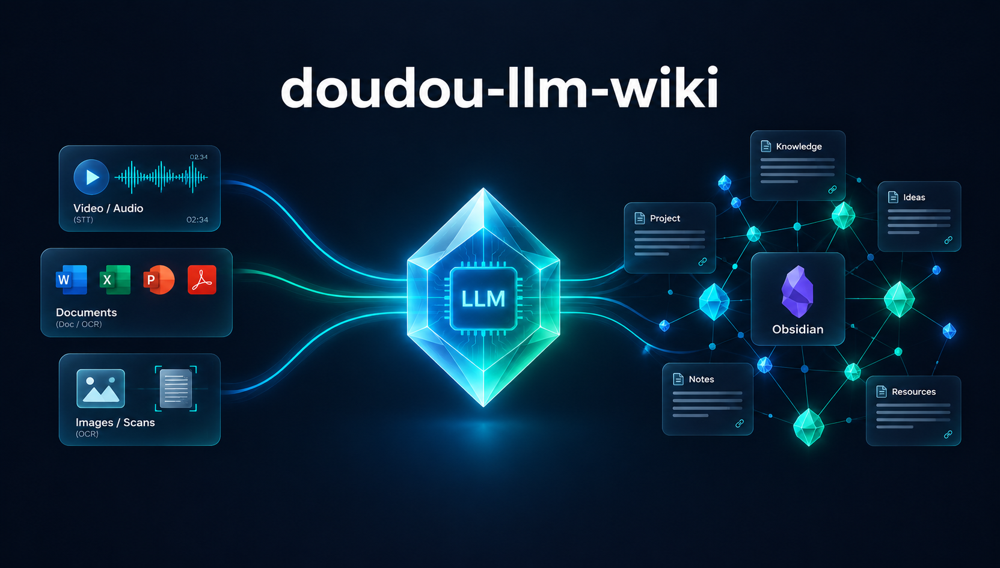
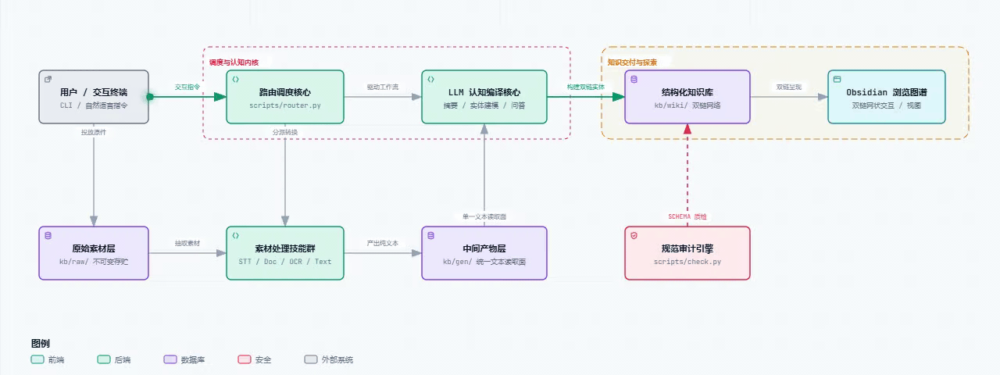

<h1 align="center">doudou-llm-wiki-skill</h1>

<p align="center">
  <b>简体中文</b> | <a href="README_EN.md">English</a>
</p>

<p align="center">
  LLM 驱动的个人知识库。LLM 负责所有繁重的整理 —— 摘要、交叉引用、归档、一致性维护；<br>
  你负责投喂素材、提好问题、思考这一切意味着什么。
</p>

<p align="center">
  
</p>

素材不限文本：**音视频、Office 文档、PDF、扫描件、图片都能收**，
分别交给 [doudou-stt](https://github.com/undsky/doudou-stt-skill) / [doudou-doc](https://github.com/undsky/doudou-doc-skill) / [doudou-ocr](https://github.com/undsky/doudou-ocr-skill) 技能预处理成文本再入库。

> 方法论见 [LLMWiki.md](LLMWiki.md)

---

## 📑 目录导航

- [🔄 工作流程图](#-工作流程图)
- [📖 技能使用指南](#-技能使用指南)
  - [1. 安装](#1-安装)
  - [2. 初始化知识库](#2-初始化知识库)
  - [3. 收录第一份素材](#3-收录第一份素材)
  - [4. 查询](#4-查询)
- [🛠️ 命令](#️-命令)
- [📚 四层架构](#-四层架构)
- [🗂️ 素材分派](#️-素材分派)
- [🗄️ Obsidian 集成](#️-obsidian-集成)
- [💬 社区与交流](#-社区与交流)
- [🙏 致敬](#-致敬)
- [📄 许可证](#-许可证)

---

## 🔄 工作流程图

<p align="center">
  
</p>

---

## 📖 技能使用指南

本项目为 https://github.com/undsky/doudou-ai-coding 提供项目级的知识库支持（支持 Antigravity、Claude Code、OpenCode 等平台）。

### 1. 安装

```bash
npx skills add undsky/doudou-llm-wiki-skill --yes
```

音视频处理（非必选）：

```bash
npx skills add undsky/doudou-stt-skill --yes
```

Office 文档处理（非必选）：

```bash
npx skills add undsky/doudou-doc-skill --yes
```

扫描件、图片、PDF文档处理（非必选）：

```bash
npx skills add undsky/doudou-ocr-skill --yes
```

### 2. 初始化知识库

```
/doudou-wiki init
```

### 3. 收录第一份素材

```bash
/doudou-wiki add [文件名]
```

也可以不自己拷 —— 直接说「收录 D:\下载\访谈.mp3」。

LLM 会自动分派转换、阅读素材、建摘要页、拆实体和概念页、维护交叉引用。

### 4. 查询

```
/doudou-wiki query xxx 是什么？
```

也可以直接说自然语言：`对比一下 RAG 和 Wiki 模式的优劣`

---

## 🛠️ 命令

| 命令                          | 功能                                                                     |
| ----------------------------- | ------------------------------------------------------------------------ |
| `/doudou-wiki init`           | 创建并注册新知识库                                                       |
| `/doudou-wiki add [文件名]`   | 收录新素材（不指定则收录全部待收录素材）                                 |
| `/doudou-wiki query <问题>`   | 基于知识库回答问题                                                       |
| `/doudou-wiki test`           | 健康检查                                                                 |
| `/doudou-wiki clear [子命令]` | 重置/删除（`all`｜`<关键词>`｜`gen`｜`trash`｜`restore`｜`empty-trash`） |
| `/doudou-wiki doctor`         | 技能自检                                                                 |
| `/doudou-wiki help`           | 帮助                                                                     |

所有命令都支持自然语言触发 —— "收录这篇文章"、"把这段录音整理进知识库"、"检查下知识库"。

---

## 📚 四层架构

| 层       | 位置          | 谁写     | 谁读     | 说明                                     |
| -------- | ------------- | -------- | -------- | ---------------------------------------- |
| 原始素材 | `<kb>/raw/`   | 你       | 一般不读 | 不可变的信息源，LLM 只读不写、默认也不读 |
| 中间产物 | `<kb>/gen/`   | 处理技能 | LLM      | 所有素材的文本化结果，可重新生成         |
| 知识库   | `<kb>/wiki/`  | LLM      | 你       | LLM 完全拥有，你通过 Obsidian 浏览       |
| 规范     | 本 skill 目录 | 你 + LLM | LLM      | Skill 代码、Schema、注册表               |

**LLM 默认只读中间产物，不读 `raw/` 原件。** 每份素材入库前都先落成 `gen/` 里的文本，
LLM 拿这一层构建 wiki。

---

## 🗂️ 素材分派

`scripts/scan.py` 按扩展名确定性判定路线，不靠猜。**每条路线都产出中间产物**：

| 素材                                                   | 路线                                                         | 产物                      |
| ------------------------------------------------------ | ------------------------------------------------------------ | ------------------------- |
| `.md` `.markdown` `.txt`                               | `text`（自带 `derive_text.py`）                              | `gen/<slug>` 沿用原扩展名 |
| `.docx` `.pptx` `.xlsx` `.csv` `.epub` `.odt` `.rtf` … | **[doudou-doc](https://github.com/undsky/doudou-doc-skill)** | `gen/<slug>.md`           |
| `.png` `.jpg` `.webp` `.tiff` …、**`.pdf`**            | **[doudou-ocr](https://github.com/undsky/doudou-ocr-skill)** | `gen/<slug>.txt`          |
| `.mp3` `.wav` `.m4a` `.mp4` `.mov` `.mkv` …            | **[doudou-stt](https://github.com/undsky/doudou-stt-skill)** | `gen/<slug>.txt`          |

---

## 🗄️ Obsidian 集成

用 Obsidian 打开知识库目录即可浏览图谱视图、反向链接和页面内容。

如果你不想用 Obsidian，可以用 VS Code 的 [Foam](https://marketplace.visualstudio.com/items?itemName=foam.foam-vscode) 插件替代。

---

## 💬 社区与交流

| 公众号                                       | QQ群（1095058701）                            |
| -------------------------------------------- | --------------------------------------------- |
|  |  |

---

## 🙏 致敬

- [Andrej Karpathy](https://gist.github.com/karpathy/442a6bf555914893e9891c11519de94f) — LLM Wiki 的原始理念（本仓库 [LLMWiki.md](LLMWiki.md)）
- [Vannevar Bush](https://en.wikipedia.org/wiki/Vannevar_Bush) — 1945 年提出 Memex 构想，个人知识管理的思想源头

## 📄 许可证

本项目采用 [CC BY-NC 4.0](LICENSE) 许可证。

- 个人使用、学习、研究与非商业项目可以直接使用。
- 公开发布衍生作品时，请注明来源。
- 商业用途需要单独授权，请联系作者。
