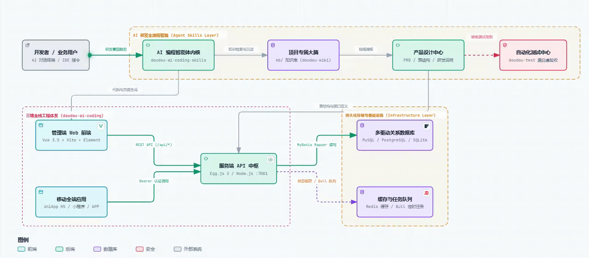

<h1 align="center">DouDou AI Coding</h1>

<p align="center">
  <b>简体中文</b> | <a href="README_EN.md">English</a>
</p>

<p align="center">
  <b>愿景：人人都能做开发</b>
</p>

<p align="center">
  豆豆（DouDou）AI 全流程开发平台，面向个人（编程小白）、小中型企业，覆盖后端服务、Web 前端和移动端h5、APP、小程序开发。
</p>

<p align="center">
  
</p>

## 准备

- 任意支持 AI 终端、IDE
- 移动开发需要安装 [HBuilderX](https://www.dcloud.io/hbuilderx.html)
- [nodejs](https://nodejs.org/zh-cn/download)
- [python](https://www.python.org/downloads/)

## 相关技能

建议拿出几分钟了解下核心技能，当然你也可以直接开始你的开发之旅。

- [doudou-llm-wiki-skill](https://github.com/undsky/doudou-llm-wiki-skill)
- [doudou-ai-coding-skills](https://github.com/undsky/doudou-ai-coding-skills)
- [ui-ux-pro-max](https://github.com/nextlevelbuilder/ui-ux-pro-max-skill)

---

## 开始开发之旅

即使你**完全不会编程、一行代码都没写过**，也只要按照下面的 5 个步骤，在 AI 对话框里输入简单的一句话，就能把脑海里的一个点子，变成真正能点击、能使用的精美软件！

<p align="center">
  
</p>

**以下所有指令都是在 AI 对话框内输入**

---

### 第 1 步：给 AI 装上“专属大脑”

```
/doudou-wiki init
```

初始化你的知识库，然后将你所有的资料一股脑丢进 `kb/raw` 目录下

```
/doudou-wiki add
```

完成！你的知识库已经建立好了。

### 第 2 步：启动环境

```
/doudou-dev 帮我把开发环境跑起来
```

完成！静待项目启动……

---

### 第 3 步：产品设计

```
/doudou-product
```

完成！产品需求文档、设计交付说明、数据库表结构、研发实现说明、测试验收用例，都将存储到 `resources/product` 目录下

---

### 第 4 步：系统开发

- 接口开发

```
描述你的需求
```

代码将自动生成到`doudou-eggjs`、`doudou-vue3`、`doudou-uniapp`目录下

- 页面开发

```
/ui-ux-pro-max 描述你的页面需求
```

完成！稍后页面会自动刷新，你可以直接在浏览器查看效果

---

### 第 5 步：自动测试

```
/doudou-test
```

完成！测试结果将保存到 `resources/test` 目录下

---

## 社区与交流

| 公众号                                       | QQ群（1095058701）                            |
| -------------------------------------------- | --------------------------------------------- |
|  |  |

---

## 许可证

本项目采用 [CC BY-NC 4.0](LICENSE) 许可证。

- 个人使用、学习、研究与非商业项目可以直接使用。
- 公开发布衍生作品时，请注明来源。
- 商业用途需要单独授权，请联系作者。
