# DouDou AI Coding 技术细节说明

> **愿景：人人都能做开发**  
> 豆豆（DouDou）AI 全流程开发平台面向个人（编程小白）与中小企业，提供覆盖 **后端服务**、**Web 管理端** 和 **移动端（H5 / APP / 小程序）** 的企业级全栈开发解决方案。

---

## 目录

- [一、整体架构与技术选型](#一整体架构与技术选型)
  - [1.1 总体架构图](#11-总体架构图)
  - [1.2 技术栈概览](#12-技术栈概览)
  - [1.3 三端通信与数据规范](#13-三端通信与数据规范)
- [二、后端服务技术细节（doudou-eggjs）](#二后端服务技术细节doudou-eggjs)
  - [2.1 核心框架与自研插件](#21-核心框架与自研插件)
  - [2.2 请求处理链路](#22-请求处理链路)
  - [2.3 MyBatis 风格 XML 与 Mapper 自动生成](#23-mybatis-风格-xml-与-mapper-自动生成)
  - [2.4 多数据库支持与读写分离机制](#24-多数据库支持与读写分离机制)
  - [2.5 权限体系（RBAC + 数据权限）](#25-权限体系rbac--数据权限)
  - [2.6 操作日志与安全审计](#26-操作日志与安全审计)
  - [2.7 定时任务与异步队列](#27-定时任务与异步队列)
  - [2.8 代码生成引擎（Velocity）](#28-代码生成引擎velocity)
- [三、Web 管理端技术细节（doudou-vue3）](#三web-管理端技术细节doudou-vue3)
  - [3.1 工程化与启动机制](#31-工程化与启动机制)
  - [3.2 动态路由与权限菜单](#32-动态路由与权限菜单)
  - [3.3 配置驱动的通用 CRUD 组件库](#33-配置驱动的通用-crud-组件库)
  - [3.4 状态管理设计（Pinia）](#34-状态管理设计pinia)
  - [3.5 网络请求与拦截器](#35-网络请求与拦截器)
  - [3.6 字典管理与权限指令](#36-字典管理与权限指令)
- [四、移动客户端技术细节（doudou-uniapp）](#四移动客户端技术细节doudou-uniapp)
  - [4.1 跨端架构与目录规范](#41-跨端架构与目录规范)
  - [4.2 路由、TabBar 与页面拦截](#42-路由tabbar-与页面拦截)
  - [4.3 跨端请求与鉴权适配](#43-跨端请求与鉴权适配)
  - [4.4 移动端状态与缓存](#44-移动端状态与缓存)
- [五、数据库设计与方言适配](#五数据库设计与方言适配)
  - [5.1 核心表结构模型](#51-核心表结构模型)
  - [5.2 多数据库（MySQL / PostgreSQL / SQLite）方言处理](#52-多数据库mysql--postgresql--sqlite方言处理)
- [六、开发、调试与部署指南](#六开发调试与部署指南)
  - [6.1 本地联调环境搭建](#61-本地联调环境搭建)
  - [6.2 常用开发指令速查](#62-常用开发指令速查)
  - [6.3 生产环境部署方案](#63-生产环境部署方案)

---

## 一、整体架构与技术选型

### 1.1 总体架构图

```
+-------------------------------------------------------------------------+
|                           前端与客户端呈现层                             |
+------------------------------------+------------------------------------+
|  Web 管理后台 (doudou-vue3)        |  多端移动客户端 (doudou-uniapp)     |
|  - Vue 3.5 + Vite + Element Plus   |  - UniApp + Vue 3 + uni-ui         |
|  - 配置化 CRUD + 动态路由权限      |  - H5 / 微信小程序 / Android / iOS |
+------------------------------------+------------------------------------+
                                      | (HTTP / RESTful API / JWT Token)
                                      v
+-------------------------------------------------------------------------+
|                        后端应用服务层 (doudou-eggjs)                     |
+-------------------------------------------------------------------------+
|  - 流量与安全: RateLimiter 限流、JWT 认证、CORS 跨域控制                 |
|  - 路由与切面: 装饰器路由、@RequiresPermissions 权限、@DataScope 数据范围 |
|  - 响应与日志: formatBody 统一响应包装、@Log 异步无感审计入库            |
|  - 异步与调度: Bull 定时任务队列 (Redis 支持)、启动字典预热              |
|  - 代码生成器: Velocity 模板引擎 (一键生成 Controller/Service/Vue/SQL)   |
+-------------------------------------------------------------------------+
                                      |
                                      v
+-------------------------------------------------------------------------+
|                        数据访问层 (MyBatis XML 机制)                     |
+-------------------------------------------------------------------------+
|  - XML 映射: mapper/{driver}/doudou/*.xml (动态 SQL、foreach、if/where) |
|  - CLI 编译: npm run mapper (自动生成 Service 封装层，业务代码零手写 SQL) |
|  - 统一连接: ctx.helper.getDB() / getMasterDB() (自动读写分离)           |
+-------------------------------------------------------------------------+
                                      |
       +------------------------------+------------------------------+
       v                              v                              v
+---------------+              +---------------+              +---------------+
| MySQL 5.7/8.0 |              | PostgreSQL 12+|              |    SQLite     |
+---------------+              +---------------+              +---------------+
```

### 1.2 技术栈概览

| 模块                             | 核心技术栈                            | 版本 / 说明                                                  |
| :------------------------------- | :------------------------------------ | :----------------------------------------------------------- |
| **后端服务** (`doudou-eggjs`)    | Node.js + Egg.js 3                    | 企业级约定式框架，Node 20+，支持 TypeScript/ES 规范          |
| **SQL 渲染**                     | `doudou-eggjs-mybatis`                | 自研 MyBatis 风格动态 SQL 语法引擎                           |
| **多库驱动**                     | `doudou-eggjs-mysql / pgsql / sqlite` | 统一抽象的多数据库客户端，自动下划线转驼峰                   |
| **缓存/任务**                    | `doudou-eggjs-cache` + Bull + Redis   | 内存/文件/Redis 多层缓存与可靠分布式任务队列                 |
| **Web 管理端** (`doudou-vue3`)   | Vue 3.5 + Vite + Element Plus + Pinia | 现代前端工程化方案，严格采用 pnpm 管理                       |
| **移动客户端** (`doudou-uniapp`) | UniApp + Vue 3 + Pinia + uni-ui       | 跨端方案，支持 H5、微信小程序、Android、iOS 一套代码编译多端 |

### 1.3 三端通信与数据规范

三端遵循统一的 RESTful API 接口与数据交互协议：

1. **响应包装规范**：
   - 列表/分页查询：
     ```json
     {
       "code": 200,
       "msg": "查询成功",
       "rows": [{ "userId": 1, "userName": "admin" }],
       "total": 100
     }
     ```
   - 实体/详情查询：
     ```json
     {
       "code": 200,
       "msg": "操作成功",
       "data": { "userId": 1, "nickName": "超级管理员" }
     }
     ```
   - 登录认证接口：
     ```json
     {
       "code": 200,
       "msg": "登录成功",
       "token": "eyJhbGciOiJIUzI1NiIsInR5cCI6IkpXVCJ9..."
     }
     ```
2. **请求头规范**：
   - `Authorization: Bearer <token>`：携带 JWT 凭证。
   - `Content-Type: application/json;charset=utf-8`。

---

## 二、后端服务技术细节（doudou-eggjs）

### 2.1 核心框架与自研插件

后端采用自研插件体系与 Egg.js 3 深度集成：

1. **`doudou-eggjs-mybatis`**：
   - 核心 API：`app.mapper(namespace, sqlid, values, params)`。
   - 实现原理：在应用启动时解析 `mapper/**/*.xml`，支持 `<select>`, `<insert>`, `<update>`, `<delete>`, `<if>`, `<where>`, `<foreach>`, `<choose>` 等 MyBatis 动态 SQL 标签。
2. **`doudou-eggjs-mysql / pgsql / sqlite`**：
   - 支持动态切换底层驱动，自动将数据库下划线字段（如 `user_name`）转换为驼峰（`userName`）。
3. **`doudou-eggjs-cache`**：
   - 统一提供 `app.cache.memory`、`app.cache.fs`、`app.cache.redis`、`app.cache.default`。
4. **`doudou-eggjs-ratelimiter`**：
   - 中间件级 IP 限流，基于令牌桶/滑动窗口保护核心接口。

### 2.2 请求处理链路

后端请求完整执行生命周期：

```
客户端请求
  │
  ├── 1. doudou-eggjs-ratelimiter (全局限流)
  ├── 2. app/middleware/formatBody.js (响应体结构规范化)
  ├── 3. app/middleware/permission.js (基础上下文挂载)
  ├── 4. egg-jwt (按 config.accessControl.match 正则拦截与 Token 解析)
  ├── 5. 装饰器路由 (egg-decorator-router: @Route / @HttpGet / @HttpPost)
  ├── 6. 控制器切面 (@RequiresPermissions / @RequiresRoles / @DataScope / @Log)
  ├── 7. Controller 业务编排
  ├── 8. 业务 Service 层
  ├── 9. 自动生成的 Mapper Service (app/service/db/{driver}/doudou/*)
  └── 10. 数据库执行与连接释放 (ctx.helper.getDB() / getMasterDB())
```

### 2.3 MyBatis 风格 XML 与 Mapper 自动生成

#### (1) XML 手写规则

文件路径：`mapper/{driver}/doudou/XxxMapper.xml`。

- `<select>`：返回单条对象（`db().select`）。
- `<selects>`：返回对象列表（`db().selects`）。
- `<insert>` / `<update>` / `<delete>`：执行相应写入与影响行数统计。

#### (2) Mapper Service 自动编译机制

运行 `npm run mapper` 命令，CLI 工具会解析所有 XML 并在 `app/service/db/{driver}/doudou/` 下自动生成对应的 JS Service：

- `xxx(values, params)`：直接调用底层数据库执行并返回结果。
- `xxxMapper(values, params)`：仅生成渲染后的 SQL 字符串与参数对象，专门用于配合 `ctx.helper.pageQuery()` 执行高效分页。

```js
// 业务 Service 分页查询标准范式
const mapper = ctx.helper.getDB(ctx).sysUserMapper;
return await ctx.helper.pageQuery(
  mapper.selectUserListMapper([], params), // 传方法名+Mapper后缀获取纯SQL
  params,
  mapper.db(),
);
```

### 2.4 多数据库支持与读写分离机制

业务代码与底层驱动解耦，统一通过 Helper 获取连接：

- **读操作**：`const db = ctx.helper.getDB(ctx)`（遵循 `config.database` 配置，开启读写分离时自动走 Slave 实例）。
- **写操作**：`const db = ctx.helper.getMasterDB(ctx)`（强制路由至 Master 主库）。

切换数据库驱动（MySQL <-> PostgreSQL <-> SQLite）仅需在 `config/config.local.js` 中修改配置，无需修改任何 Controller 或 Service 代码。

### 2.5 权限体系（RBAC + 数据权限）

#### (1) 操作权限（功能权限）

基于注解 `@RequiresPermissions` 与 `@RequiresRoles`：

- 支持通配符：如 `system:user:add`、`system:user:*`、`*:*:*`（超级管理员）。
- 支持多权限条件：`@RequiresPermissions(['system:user:add', 'system:user:edit'], 'OR')`。
- 权限判定数据缓存在 Redis/内存中 10 分钟，提升并发吞吐。

#### (2) 数据权限（行级权限）

使用 `@DataScope({ deptAlias: 'd', userAlias: 'u' })` 装饰器：

- 自动根据当前登录用户的角色数据范围配置（全部数据、自定义部门、本部门、本部门及以下、仅本人）。
- 动态在 `params.dataScope` 中构建 SQL 条件片段，自动拼接进 XML 的 `${dataScope}` 语句中。
- 内置防 SQL 注入过滤，超级管理员（`userId === 1`）自动跳过限制。

### 2.6 操作日志与安全审计

使用 `@Log({ title: '用户管理', businessType: BusinessType.INSERT })` 切面：

- 记录操作人员、请求 URL、IP 地址、归属地、浏览器/系统、请求参数、返回结果、执行状态及耗时。
- 内部采用 `setImmediate` 异步落库，完全不阻塞主业务请求响应。
- 自动识别并对 `password`、`oldPassword` 等敏感字段进行脱敏（`******`）处理。

### 2.7 定时任务与异步队列

- 基于 `@hackycy/egg-bull` + Redis 实现 Bull 任务队列。
- 任务执行调度位于 `app/queue/ryTask.js`，通过数据库表 `sys_job` 进行动态启停、Cron 表达式配置与运行日志记录（`sys_job_log`）。
- 具备并发控制、失败重试及任务状态持久化能力。

### 2.8 代码生成引擎（Velocity）

- 位于 `app/service/tool/gen.js`，支持逆向解析数据库表元数据（字段名、数据类型、注释、主外键）。
- 基于 `velocityjs` 模板渲染引擎：
  - 生成 Egg.js Controller、Service、Mapper XML
  - 生成 Vue 3 Element Plus 列表、表单、对话框组件
  - 生成 API 封装文件与自动插入菜单/按钮权限的 SQL 脚本

---

## 三、Web 管理端技术细节（doudou-vue3）

### 3.1 工程化与启动机制

- **构建工具**：Vite 5+，极致的毫秒级 HMR 热更新体验。
- **包管理器**：严格使用 `pnpm`（内置 `preinstall` 脚本，保障依赖锁一致）。
- **环境配置**：
  - `.env.development`：开发环境配置，`VITE_APP_BASE_API = '/api'`。
  - `.env.production`：生产构建配置。
- **Vite 代理配置**：将 `/api/*` 请求透明代理至 Egg.js 监听的 `http://localhost:7001`。

### 3.2 动态路由与权限菜单

1. **路由分类**：
   - **恒常路由 (Constant Routes)**：登录 `/login`、404、重定向等无需权限的路由。
   - **动态路由 (Dynamic Routes)**：用户登录后，调用 `/getRouters` 接口获取服务端菜单树，递归格式化为前端路由配置并通过 `router.addRoute()` 动态挂载。
2. **路由拦截守卫**：
   - 检查 Pinia 中是否存在 Token：无 Token 则重定向至登录页。
   - 有 Token 时，首次加载自动拉取用户信息（角色、权限列表）及菜单路由。

### 3.3 配置驱动的通用 CRUD 组件库

项目沉淀了高效的企业级低代码通用组件：

- **`BaseForm`**：通过 JSON Schema 配置生成表单项（输入框、下拉框、日期选择器、树形选择等），自带表单校验与联动。
- **`BaseTable`**：配置列属性、格式化渲染、操作栏按钮、分页联动、多选与排序。
- **`PageContent`**：封装标准化列表页容器，统一处理分页请求、刷新、搜索与导出。
- **`PageSearch`**：标准化搜索栏组件，支持重置、展开/收起、自定义插槽。
- **`PageDialog`**：封装新增/修改弹窗生命周期。

### 3.4 状态管理设计（Pinia）

- **模块化设计**：
  - `store/modules/user.js`：存储当前登录用户信息、Token、权限标识集合（`permissions`）、角色集合（`roles`）。
  - `store/modules/permission.js`：管理动态路由表与侧边栏菜单结构。
  - `store/modules/dict.js`：字典缓存体系。
- **通用业务状态（`store/business/`）**：
  - 采用唯一 `pageName` 作为隔离键，标准化管理各业务列表页的查询参数与分页状态。

### 3.5 网络请求与拦截器

封装于 `src/utils/request.js`：

- **请求拦截**：自动从 Pinia / 本地缓存提取 Token 并挂载至 `Authorization` 头；防止重复提交（防抖机制）。
- **响应拦截**：
  - 拦截 `401`（Token 过期/无效）：触发退出登录并跳转登录页。
  - 拦截 `403` / `500` / 业务错误码：使用 Element Plus `ElMessage.error` 统一弹出友好的错误提示。
  - 二进制流文件导出适配（Excel 下载）。

### 3.6 字典管理与权限指令

- **自定义指令**：
  - `v-hasPermi="['system:user:add']"`：细粒度控制按钮等 DOM 元素的显示与销毁。
  - `v-hasRole="['admin']"`：基于角色标识的显隐控制。
- **字典工具**：
  - `useDict('sys_user_sex', 'sys_normal_disable')`：响应式批量加载并缓存数据字典，结合 `dict-tag` 组件统一展示标签色彩。

---

## 四、移动客户端技术细节（doudou-uniapp）

### 4.1 跨端架构与目录规范

- 基于 **UniApp (Vue 3)** 框架开发，支持一键编译至：
  - 移动端 Web (H5)
  - 微信小程序 (WeChat Mini Program)
  - Android 原生 App
  - iOS 原生 App
- 采用官方推荐的 `uni_modules` 规范集成 `uni-ui` 高性能组件库。

### 4.2 路由、TabBar 与页面拦截

- **`pages.json`**：统一声明页面路由、窗口样式、下拉刷新及底部原生 TabBar（首页、工作台、我的）。
- **`permission.js`**：页面导航守卫，针对需要登录访问的页面进行路由拦截与跳转引导。

### 4.3 跨端请求与鉴权适配

封装于 `doudou-uniapp/utils/request.js`：

- 底层使用 `uni.request`，统一抹平不同终端的网络通信差异。
- 请求拦截自动附加 `Bearer ` Token（通过 `uni.getStorageSync('token')` 读取）。
- 支持小程序端网络超时重试与错误提示 Toast。

### 4.4 移动端状态与缓存

- 基于 Pinia 管理全局用户状态与应用配置。
- 采用 `uni.setStorageSync` / `uni.getStorageSync` 实现全终端统一的本地离线缓存。

---

## 五、数据库设计与方言适配

### 5.1 核心表结构模型

系统核心内置表结构：

| 表名                     | 模块     | 核心功能                                                    |
| :----------------------- | :------- | :---------------------------------------------------------- |
| `sys_user`               | 用户体系 | 用户账号、昵称、密码哈希、部门、手机、状态                  |
| `sys_role`               | 角色体系 | 角色名称、权限字符、数据范围（全部/本部门/自定义）          |
| `sys_menu`               | 菜单权限 | 路由地址、组件路径、权限标识（如 `system:user:list`）、图标 |
| `sys_dept`               | 组织架构 | 树形部门层级结构、负责人、联系方式                          |
| `sys_dict_type` / `data` | 数据字典 | 业务常量字典与标签展示配置                                  |
| `sys_config`             | 系统参数 | 动态配置项（如验证码开关、初始密码等）                      |
| `sys_job` / `log`        | 定时任务 | 任务表达式、调用目标、执行日志                              |
| `sys_oper_log`           | 审计日志 | 系统操作日志记录                                            |

### 5.2 多数据库（MySQL / PostgreSQL / SQLite）方言处理

由于不同数据库在日期函数、字符串拼接和分页语法上存在差异，`mapper/` 目录下为三大数据库分别维护独立的 XML 文件：

| 功能特性          | MySQL                      | PostgreSQL                    | SQLite                         |
| :---------------- | :------------------------- | :---------------------------- | :----------------------------- |
| **字符串拼接**    | `concat('%', #{val}, '%')` | `concat('%', #{val}, '%')`    | `('%' \|\| #{val} \|\| '%')`   |
| **当前时间函数**  | `sysdate()` / `now()`      | `now()` / `current_timestamp` | `datetime('now', 'localtime')` |
| **分页语法**      | `LIMIT offset, limit`      | `LIMIT limit OFFSET offset`   | `LIMIT limit OFFSET offset`    |
| **自增主键**      | `AUTO_INCREMENT`           | `SERIAL` / `BIGSERIAL`        | `AUTOINCREMENT`                |
| **类型转换/比较** | 弱类型自动转换             | 严格类型检查（需显式转类型）  | 动态类型                       |

---

## 六、开发、调试与部署指南

### 6.1 本地联调环境搭建

#### 步骤 1：数据库初始化

进入 `doudou-eggjs/sql/` 目录，根据你选择的数据库类型导入基础 SQL（如 `mysql.sql` 或 `pgsql.sql` 或 `sqlite.sql`）。

#### 步骤 2：启动后端服务 (`doudou-eggjs`)

```bash
cd doudou-eggjs
npm install
npm run dev      # 自动编译 Mapper 并启动 7001 端口开发服务
```

#### 步骤 3：启动 Web 管理端 (`doudou-vue3`)

```bash
cd doudou-vue3
pnpm install
pnpm dev         # 启动前端 Vite 服务（默认端口 80，自动反向代理到 7001）
```

#### 步骤 4：启动移动端 (`doudou-uniapp`)

- 使用 **HBuilderX** 打开 `doudou-uniapp` 目录。
- 点击顶部菜单【运行】->【运行到浏览器】（H5）或【运行到小程序模拟器】（微信开发者工具）。

### 6.2 常用开发指令速查

```bash
# 后端 (doudou-eggjs)
npm run mapper   # 修改 XML 后，重新生成 Mapper Service
npm run dev      # 启动开发服务器（含自动 mapper 生成）
npm run build    # 构建生产包至 dist/
npm start        # 生产模式后台守护进程启动
npm stop         # 停止生产守护进程

# Web 管理端 (doudou-vue3)
pnpm dev         # 启动 Vite 本地开发热重载
pnpm build:prod  # 构建生产静态产物至 dist/
pnpm prettier    # 一键代码风格格式化
```

### 6.3 生产环境部署方案

#### 1. 前端与管理端（Nginx 部署）

将 `doudou-vue3` 构建生成的 `dist/` 目录放入 Nginx Web 根目录，配合以下典型反向代理配置：

```nginx
server {
    listen       80;
    server_name  your-domain.com;

    # Web 管理端静态资源
    location / {
        root   /var/www/doudou-vue3/dist;
        index  index.html index.htm;
        try_files $uri $uri/ /index.html;
    }

    # 后端 API 反向代理
    location /api/ {
        proxy_pass http://127.0.0.1:7001/;
        proxy_set_header Host $host;
        proxy_set_header X-Real-IP $remote_addr;
        proxy_set_header X-Forwarded-For $proxy_add_x_forwarded_for;
    }
}
```

#### 2. 后端服务部署

- 推荐使用 Node.js 20+ 环境，使用 PM2 或 Egg 内置 `egg-scripts` 进行集群守护运行：
  ```bash
  cd doudou-eggjs
  npm run build
  npm start -- --env=prod
  ```

## 项目组成

| 应用       | 目录                               | 技术栈                            | 说明                                                        |
| ---------- | ---------------------------------- | --------------------------------- | ----------------------------------------------------------- |
| 后端服务   | [`doudou-eggjs/`](doudou-eggjs/)   | Node.js 20+、Egg.js 3             | 企业级 API 与后台管理后端，支持 MySQL、PostgreSQL 和 SQLite |
| Web 管理端 | [`doudou-vue3/`](doudou-vue3/)     | Vue 3.5、Vite、Element Plus、pnpm | 后台管理 Web UI                                             |
| 移动客户端 | [`doudou-uniapp/`](doudou-uniapp/) | UniApp、Vue 3、Pinia、uni-ui      | 支持 H5、小程序和原生端                                     |

## 快速导航

- [📖 全平台技术细节与架构说明文档](TECHNICAL_DETAILS.md)
- [后端服务：DouDou-Eggjs](#后端服务doudou-eggjs)
- [Web 管理端：DouDou-Vue3](#web-管理端doudou-vue3)
- [移动客户端：DouDou-UniApp](#移动客户端doudou-uniapp)

---

## 后端服务：DouDou-Eggjs

## DouDou-Eggjs

> 豆豆（DouDou）Node.js 版本，基于 Egg.js 企业级框架

> 打造面向小中型企业的 AI 全流程开发平台。平替产品、设计、开发、测试、运维岗位的生产力工具。
> 以快速开发、快速交付、快速迭代为核心理念。

[](LICENSE)
[](https://nodejs.org)
[](https://eggjs.org)

### 📑 目录导航

- [平台简介](#平台简介)
- [演示项目](#演示项目)
- [前端项目](#前端项目)
- [特性](#-特性)
- [项目结构](#-项目结构)
- [快速开始](#-快速开始)
- [部署说明](#-部署说明)
- [请我喝杯咖啡](#请我喝杯咖啡)
- [参与贡献](#-参与贡献)
- [开源协议](#-开源协议)
- [鸣谢](#-鸣谢)
- [联系方式](#-联系方式)
- [友情链接](#友情链接)

### 平台简介

基于 Egg.js 框架开发的企业级后台管理系统。采用 MyBatis XML 风格编写 SQL。

| 公众号                                       | QQ群                                          |
| -------------------------------------------- | --------------------------------------------- |
|  |  |

### 演示项目

- 🖥️ Element Plus 版本：http://ry.undsky.com/admin/login?redirect=/index
- 🎨 Vue3 Prettier 版本：http://ry2.undsky.com/login?redirect=/index
- 🐻 BearJia Vue3 版本：http://ry1.undsky.com/login3

### 前端项目

**DouDou-Vue3**: [https://gitee.com/mc-springboot/doudou-vue3](https://gitee.com/mc-springboot/doudou-vue3)

**配置后端接口**：

在前端项目的 `vite.config.js` 中设置后端接口地址：

```javascript
const baseUrl = "http://localhost:7001"; // 后端接口
```

### ✨ 特性

#### 核心特性

- 🗄️ **MyBatis XML 编写 SQL** - 业务逻辑与 SQL 分离，支持动态 SQL（[文档](https://github.com/undsky/doudou-eggjs-mybatis)）
- 🔌 **多数据库支持** - 支持 MySQL、PostgreSQL、SQLite 等多种数据库，支持多数据源配置（[MySQL](https://github.com/undsky/doudou-eggjs-mysql) | [PostgreSQL](https://github.com/undsky/doudou-eggjs-pgsql) | [SQLite](https://github.com/undsky/doudou-eggjs-sqlite)）
- 🤖 **代码自动生成** - 基于 XML Mapper 自动生成 Service 层代码（[文档](https://github.com/undsky/doudou-eggjs-cli)）
- 🌐 **内网穿透** - 内置 FRP 客户端，快速将本地服务暴露到公网（[文档](https://github.com/undsky/doudou-eggjs-cli#frp-内网穿透)）
- 🎯 **路由注解** - 使用装饰器定义路由，简洁优雅（[文档](https://github.com/fyl080801/egg-decorator-router)）
- ⏰ **定时任务调度** - 基于 egg-bull 实现动态定时任务，支持从数据库读取 cron 表达式、手动执行、失败重试、分布式支持、任务日志记录和可视化监控（[文档](https://github.com/brickyang/egg-bull)）
- 🚀 **缓存支持** - 多层级缓存策略（内存、文件、Redis）（[文档](https://github.com/undsky/doudou-eggjs-cache)）
- 🛡️ **限流保护** - API 请求频率限制，防止恶意攻击（[文档](https://github.com/undsky/doudou-eggjs-ratelimiter)）
- 🔐 **JWT 认证** - 基于 JWT 的用户认证和权限控制（[文档](https://github.com/okoala/egg-jwt)）
- 🔒 **权限控制** - 类似 Spring Boot `@PreAuthorize` 的权限装饰器，支持通配符、AND/OR 逻辑
- 💡 **IDE 智能提示** - 完整的 TypeScript 类型定义，支持代码跳转、智能提示和参数提示

#### 技术栈

| 技术                          | 版本     | 说明                |
| ----------------------------- | -------- | ------------------- |
| [Node.js](https://nodejs.org) | >=20.0.0 | JavaScript 运行时   |
| [Egg.js](https://eggjs.org)   | ^3       | 企业级 Node.js 框架 |

#### 自研插件

| 插件                                                                           | 说明                       | 文档                                                         |
| ------------------------------------------------------------------------------ | -------------------------- | ------------------------------------------------------------ |
| [doudou-eggjs-mybatis](https://github.com/undsky/doudou-eggjs-mybatis)         | MyBatis XML SQL 映射       | [README](https://github.com/undsky/doudou-eggjs-mybatis)     |
| [doudou-eggjs-mysql](https://github.com/undsky/doudou-eggjs-mysql)             | MySQL 数据库操作           | [README](https://github.com/undsky/doudou-eggjs-mysql)       |
| [doudou-eggjs-pgsql](https://github.com/undsky/doudou-eggjs-pgsql)             | PostgreSQL 数据库操作      | [README](https://github.com/undsky/doudou-eggjs-pgsql)       |
| [doudou-eggjs-sqlite](https://github.com/undsky/doudou-eggjs-sqlite)           | SQLite 数据库操作          | [README](https://github.com/undsky/doudou-eggjs-sqlite)      |
| [doudou-eggjs-cache](https://github.com/undsky/doudou-eggjs-cache)             | 多层级缓存                 | [README](https://github.com/undsky/doudou-eggjs-cache)       |
| [doudou-eggjs-ratelimiter](https://github.com/undsky/doudou-eggjs-ratelimiter) | API 限流                   | [README](https://github.com/undsky/doudou-eggjs-ratelimiter) |
| [doudou-eggjs-cli](https://github.com/undsky/doudou-eggjs-cli)                 | 代码生成工具、FRP 内网穿透 | [README](https://github.com/undsky/doudou-eggjs-cli)         |
| [doudou-eggjs-handlebars](https://github.com/undsky/doudou-eggjs-handlebars)   | Handlebars 模板引擎        | [README](https://github.com/undsky/doudou-eggjs-handlebars)  |

### 📦 项目结构

```
doudou-eggjs/
├── app/
│   ├── controller/          # 控制器
│   │   ├── system/         # 系统模块控制器
│   │   │   ├── user.js    # 用户管理
│   │   │   ├── role.js    # 角色管理
│   │   │   ├── menu.js    # 菜单管理
│   │   │   ├── dept.js    # 部门管理
│   │   │   ├── post.js    # 岗位管理
│   │   │   ├── dictType.js # 字典类型
│   │   │   ├── dictData.js # 字典数据
│   │   │   ├── config.js  # 参数配置
│   │   │   ├── notice.js  # 通知公告
│   │   │   ├── profile.js # 个人中心
│   │   │   └── login.js   # 登录认证
│   │   ├── monitor/        # 监控模块控制器
│   │   │   ├── online.js  # 在线用户
│   │   │   ├── logininfor.js # 登录日志
│   │   │   ├── operlog.js # 操作日志
│   │   │   ├── server.js  # 服务监控
│   │   │   ├── cache.js   # 缓存监控
│   │   │   ├── job.js     # 定时任务
│   │   │   └── jobLog.js  # 任务日志
│   │   ├── tool/           # 工具模块控制器
│   │   ├── common.js       # 公共接口（上传/下载）
│   │   └── index.js        # 首页控制器
│   ├── service/            # 服务层
│   │   ├── db/            # 数据库服务（自动生成）
│   │   │   └── mysql/
│   │   │       └── doudou/ # 豆豆系统表服务
│   │   ├── system/        # 系统模块服务
│   │   ├── monitor/       # 监控模块服务
│   │   ├── tool/          # 工具模块服务
│   │   ├── ryTask.js      # 定时任务执行类
│   │   └── upload.js      # 文件上传服务
│   ├── decorator/          # 装饰器
│   │   ├── permission.js  # 权限控制装饰器
│   │   └── log.js         # 操作日志装饰器
│   ├── middleware/         # 中间件
│   │   ├── permission.js  # 权限验证中间件
│   │   └── formatBody.js  # 响应格式化
│   ├── queue/             # 队列处理器
│   │   └── ryTask.js      # 定时任务队列
│   ├── extend/            # 框架扩展
│   ├── constant/          # 常量定义
│   ├── util/              # 工具类
│   ├── templates/         # 代码生成模板
│   └── public/            # 静态资源
│       └── uploads/       # 上传文件目录
├── config/
│   ├── config.default.js  # 默认配置
│   ├── config.local.js    # 本地开发配置
│   ├── config.prod.js     # 生产环境配置
│   └── plugin.js          # 插件配置
├── mapper/                # MyBatis XML 映射文件
│   └── mysql/
│       └── doudou/        # 豆豆系统表 Mapper
│           ├── SysUserMapper.xml
│           ├── SysRoleMapper.xml
│           ├── SysMenuMapper.xml
│           └── ...
├── sql/                   # SQL 脚本文件
├── docs/                  # 文档目录
├── typings/               # TypeScript 类型定义
├── cache/                 # 文件缓存目录
├── logs/                  # 日志目录
├── run/                   # 运行时文件
├── app.js                 # 应用启动配置
├── package.json
└── README.md
```

### 🚀 快速开始

#### 环境要求

- Node.js >= 20.0.0
- 数据库（三选一）：MySQL >= 5.7 / PostgreSQL >= 10 / SQLite >= 3
- Redis >= 5.0

#### 1. 克隆项目

```bash
git clone https://github.com/undsky/doudou-eggjs.git
cd doudou-eggjs
```

#### 2. 安装依赖

```bash
npm install
```

#### 3. 导入数据库

项目支持 MySQL、PostgreSQL、SQLite 三种数据库，SQL 脚本位于 `sql/` 目录下：

```
sql/
├── mysql/     # MySQL 初始化脚本
├── pgsql/     # PostgreSQL 初始化脚本
└── sqlite/    # SQLite 初始化脚本
```

##### MySQL

```sql
-- 创建数据库
CREATE DATABASE IF NOT EXISTS doudou DEFAULT CHARSET utf8mb4 COLLATE utf8mb4_general_ci;

-- 导入数据表和数据
mysql -u root -p doudou < sql/mysql/doudou.sql
```

##### PostgreSQL

```sql
-- 创建数据库
CREATE DATABASE doudou;
\c doudou

-- 导入数据表和数据
psql -U doudou -d doudou -f sql/pgsql/doudou.sql
```

##### SQLite

SQLite 无需创建数据库，直接导入脚本即可：

```bash
sqlite3 doudou.db < sql/sqlite/doudou.sql
```

#### 4. 配置数据库和 Redis

根据选择的数据库类型，在 `config/config.local.js` 中配置：

##### MySQL 配置

```javascript
config.mysql = {
  camelCase: true, // 启用驼峰命名转换：user_name -> userName
  clients: {
    doudou: {
      host: "127.0.0.1",
      user: "root",
      password: "your_password",
      database: "doudou",
    },
  },
};
```

##### PostgreSQL 配置

```javascript
config.pgsql = {
  camelCase: true,
  clients: {
    doudou: {
      host: "127.0.0.1",
      user: "doudou",
      password: "your_password",
      database: "doudou",
    },
  },
};
```

##### SQLite 配置

```javascript
config.sqlite = {
  camelCase: true,
  clients: {
    doudou: {
      database: "./doudou.db", // 数据库文件路径
    },
  },
};
```

##### Redis 配置

```javascript
const redis = {
  port: 6379,
  host: "127.0.0.1",
  password: "",
  db: 5,
};
```

#### 5. 运行项目

##### 开发模式

开发模式会自动启动 Mapper 代码生成器和调试服务：

```bash
npm run dev
```

##### 生产模式

```bash
## 启动
npm start

## 停止
npm stop
```

##### 命令说明

```bash
## 开发模式（自动生成 Mapper + 调试）
npm run dev

## 仅生成 Mapper 代码
npm run mapper

## 仅启动调试服务
npm run debug

## 生产模式启动
npm start

## 停止服务
npm stop
```

#### 6. 访问应用

打开浏览器访问：[http://localhost:7001](http://localhost:7001)

测试接口：

- 版本信息：`GET http://localhost:7001/version`

### 🚢 部署说明

#### 使用 egg-scripts 部署

```bash
## 安装依赖
npm install --production

## 启动服务（后台运行）
npm start

## 停止服务
npm stop
```

#### 使用 PM2 部署

参考
[如何使用 PM2 启动应用](https://eggjs.org/zh-CN/community/faq#%E8%BF%9B%E7%A8%8B%E7%AE%A1%E7%90%86%E4%B8%BA%E4%BB%80%E4%B9%88%E6%B2%A1%E6%9C%89%E9%80%89%E5%9E%8B-pm2)

#### Nginx 反向代理

```nginx
server {
    listen 80;
    server_name your-domain.com;

    # 前端项目
    location / {
      root   /www/wwwroot/项目目录;
      try_files $uri $uri/ /index.html;
            index  index.html index.htm;
        }

## 后端接口
    location /prod-api/ {
            proxy_set_header Host $http_host;
            proxy_set_header X-Real-IP $remote_addr;
            proxy_set_header REMOTE-HOST $remote_addr;
            proxy_set_header X-Forwarded-For $proxy_add_x_forwarded_for;
            proxy_pass http://localhost:项目运行端口/;
            # ai stream
            proxy_buffering off;
            proxy_cache off;
            proxy_set_header Connection '';
            proxy_http_version 1.1;
            chunked_transfer_encoding off;
        }
}
```

### 请我喝杯咖啡

如果项目对你有帮助，可以请我喝杯咖啡 ☕️

 

### 🤝 参与贡献

欢迎提交 Issue 和 Pull Request！

1. Fork 本仓库
2. 创建特性分支 (`git checkout -b feature/AmazingFeature`)
3. 提交改动 (`git commit -m 'Add some AmazingFeature'`)
4. 推送到分支 (`git push origin feature/AmazingFeature`)
5. 提交 Pull Request

### 📄 开源协议

本项目基于 [MIT](LICENSE) 协议开源。

### 🙏 鸣谢

- [Egg.js](https://eggjs.org) - 企业级 Node.js 框架
- 所有贡献者

### 📞 联系方式

- 网站：[https://www.undsky.com](https://www.undsky.com)
- GitHub：[https://github.com/undsky/doudou-eggjs](https://github.com/undsky/doudou-eggjs)
- Issues：[https://github.com/undsky/doudou-eggjs/issues](https://github.com/undsky/doudou-eggjs/issues)

### 友情链接

- [LINUX DO - 新的理想型社区](https://linux.do/)

---

## Web 管理端：DouDou-Vue3

## 若依前后端分离-js版本-前端

### 体验地址

http://www.xiexiepa.cn/

### 项目介绍

1. 本项目可以完美的对接原版本的ruoyi前后端分离版本的后端

2. 本项目重构了若依前后端分离版本的前端70%的代码，代码高度内聚，并优化了界面的ui。

### 其他版本

| 版本               | 技术栈                      | 仓库                                                                                         |
| ------------------ | --------------------------- | -------------------------------------------------------------------------------------------- |
| ruoyi-vue3-lmw     | Vue 3 + JS + Element Plus   | [gitee.com/codelm/ruoyi-vue3-lmw](https://gitee.com/codelm/ruoyi-vue3-lmw.git)               |
| ruoyi-vue3-lmw-ts  | Vue 3 + TS + Element Plus   | [gitee.com/codelm/ruoyi-vue3-lmw-ts](https://gitee.com/codelm/ruoyi-vue3-lmw-ts.git)         |
| ruoyi-pritter-antd | Vue 3 + JS + Ant Design Vue | [github.com/w-yahaha/ruoyi-pritter-antd](https://github.com/w-yahaha/ruoyi-pritter-antd.git) |

### 技术选型

- 开发语言：JavaScript
- 基础框架：Vue3.5.x
- 构建工具：Vite
- 组件库：Element-Plus
- 包管理器：pnpm
- ...

### Node版本

- Node20.10.0以上

### 前端运行

```bash
## 克隆项目
git clone https://gitee.com/codelm/ruoyi-vue3-lmw.git

## 进入项目目录
cd ruoyi-vue3-lmw

## 安装依赖
pnpm install

## 启动服务
pnpm dev

## 打包项目
pnpm build:prod

```

### 演示图

<table>
  <tr>
    <td></td>
    <td></td>
  </tr>
  <tr>
    <td>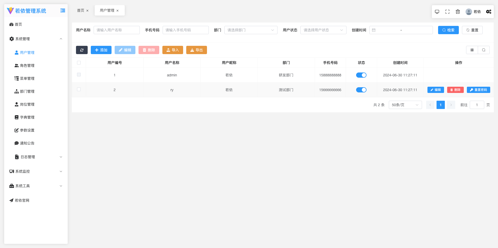</td>
    <td>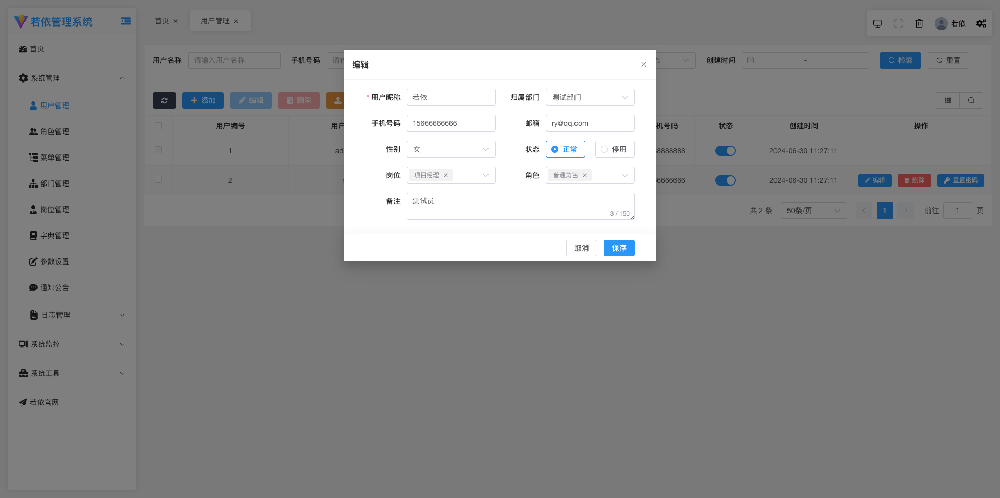</td>
  </tr>
  <tr>
    <td></td>
    <td></td>
  </tr>
  <tr>
    <td></td>
    <td>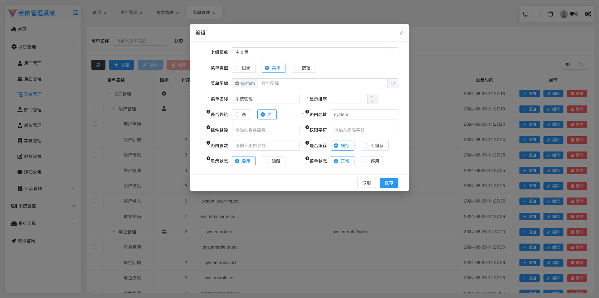</td>
  </tr>
  <tr>
    <td></td>
    <td>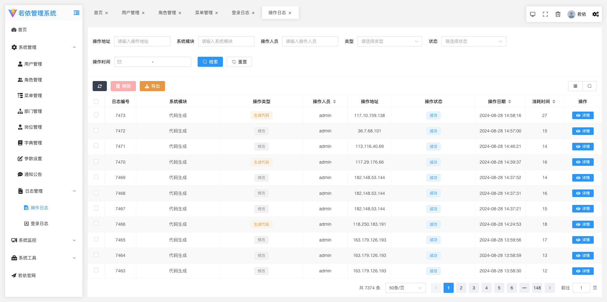</td>
  </tr>
  <tr>
    <td>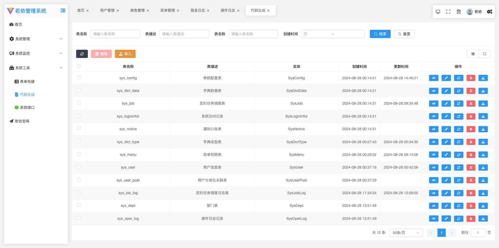</td>
    <td>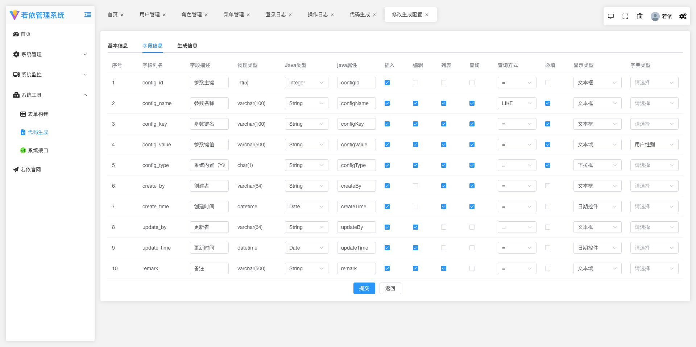</td>
  </tr>
  <tr>
    <td>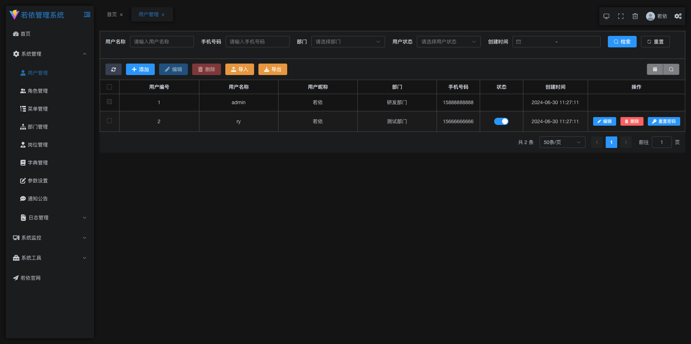</td>
    <td>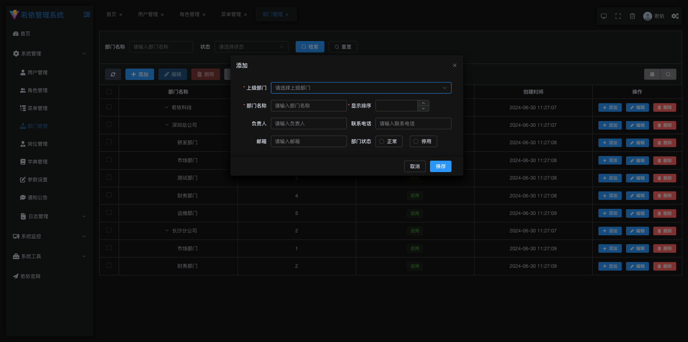</td>
  </tr>
  <tr>
    <td></td>
    <td></td>
  </tr>
  <tr>
    <td></td>
    <td>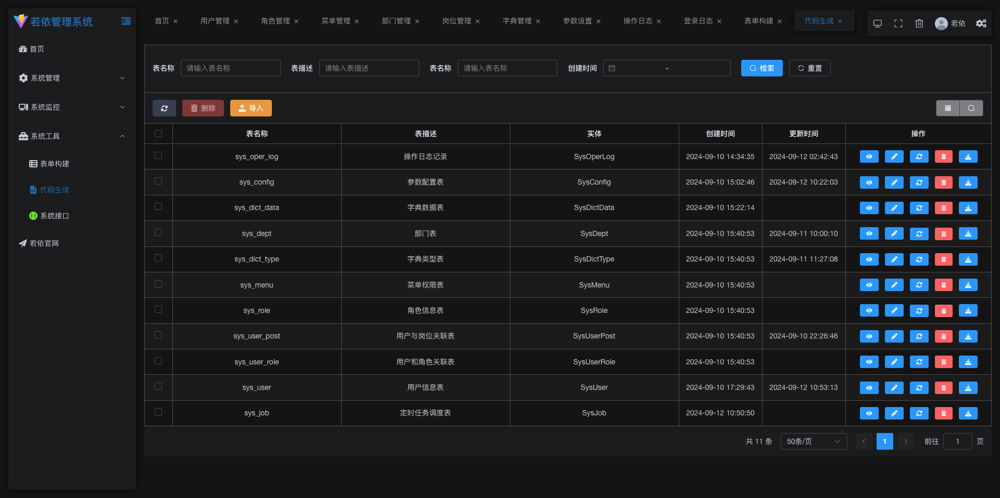</td>
  </tr>
    <td>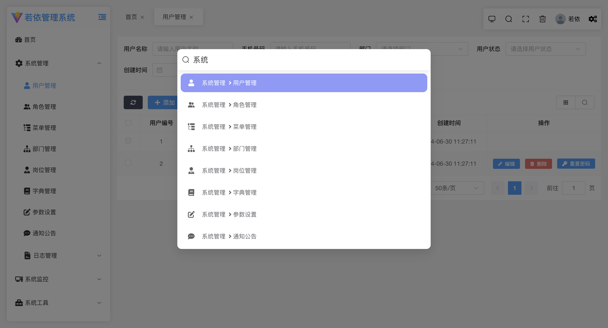</td>
    <td></td>
  </tr>
    </tr>
    <td>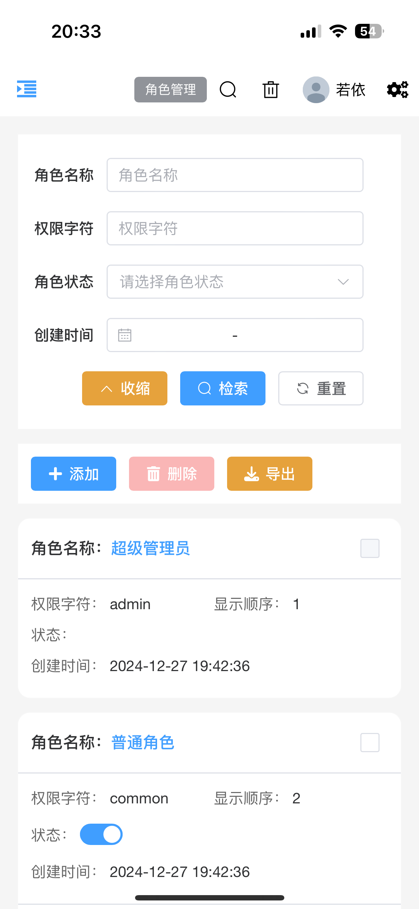</td>
    <td>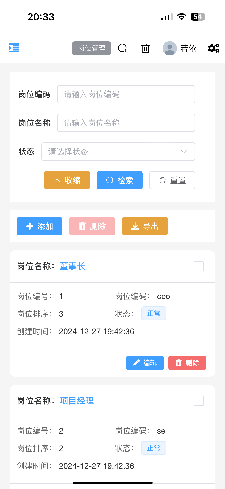</td>
  </tr>
  </tr>
    <td>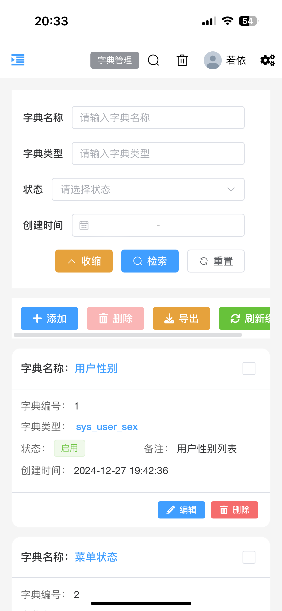</td>
    <td>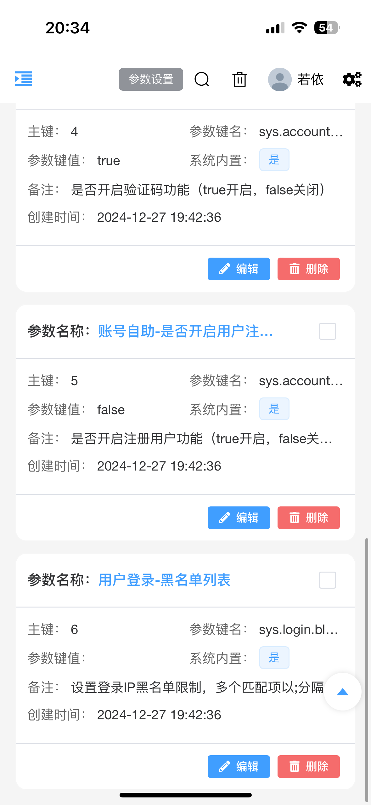</td>
  </tr>
  </tr>
    <td></td>
    <td>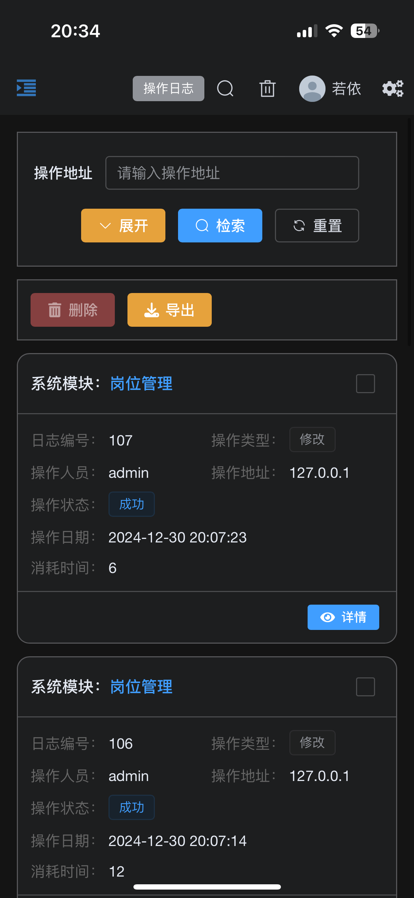</td>
  </tr>
  </tr>
    <td>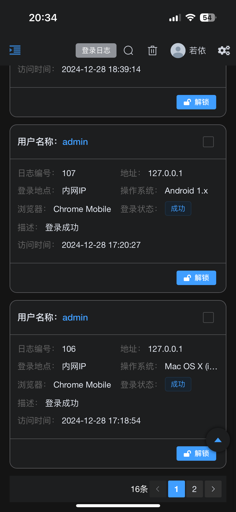</td>
    <td>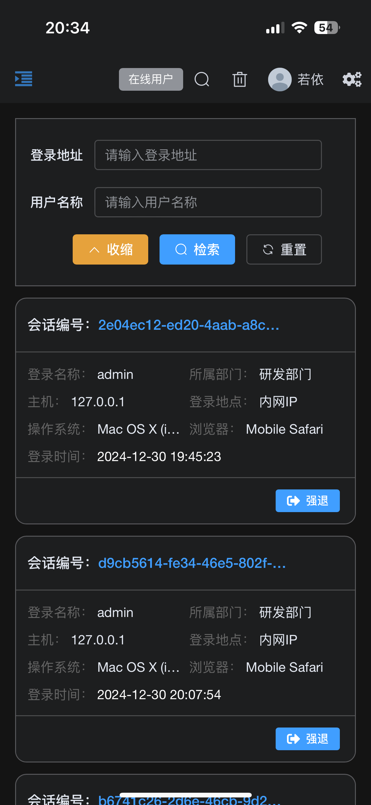</td>
  </tr>
  </tr>
    <td>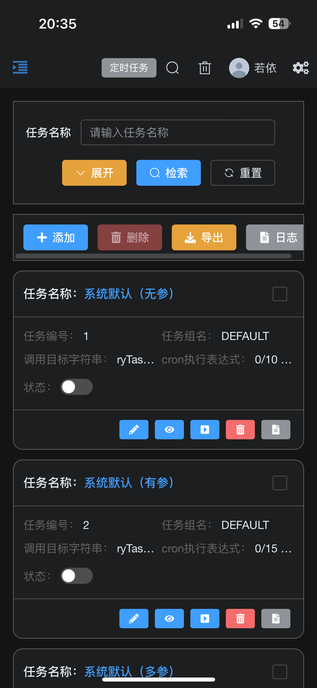</td>
    <td></td>
  </tr>
</table>

### 联系本人

本人微信：di_huhu ，欢迎大家加入群聊提供建议，
无需捐赠，如果觉得项目不错，或者已经在使用了，希望你可以去帮我点个 ⭐ Star。

### 目录结构

```tree
├── BaseComponent				//脱离所有业务的组件
├── api									//网络请求
├── assets							//静态资源
├── components					//全局业务组件
├── directive						//全局指令
├── hooks								//hooks
├── layout							//布局
├── plugins							//通用方法
├── router							//路由
├── store								//全局 store管理
├── utils								//全局公用方法
├── views								//所有页面
├── App.vue             // 入口页面
└── main.js             // 入口 加载组件 初始化等
```

### 前端页面生成模板

参考本项目中的ruoyi-generator文件夹

### 组件使用说明

#### 1、BaseForm

##### 属性

| 属性名       | 说明                                                                                                                                           | 类型         | 默认值                                                                                    |
| ------------ | ---------------------------------------------------------------------------------------------------------------------------------------------- | ------------ | ----------------------------------------------------------------------------------------- |
| elFormConfig | element-plus的Form组件参数                                                                                                                     | `Object`     | {}                                                                                        |
| allDisabled  | 是否禁用所有操作框                                                                                                                             | `boolean`    | false                                                                                     |
| formItems    | 需要渲染的form项，具体参考下方的formItem                                                                                                       | `Array`      | []                                                                                        |
| data         | 表单数据                                                                                                                                       | `Object`     | 必填                                                                                      |
| itemStyle    | 每个formItem的样式                                                                                                                             | `Object`     | { padding: '0px 20px 0px 0px' }                                                           |
| colLayout    | 单个formItem布局配置，参考element-plus的<a href="https://element-plus.org/zh-CN/component/layout.html#col-api">Layout组件</a>                  | `Object`     |                                                                                           |
| footerLayout | footer插槽的布局配置，参数同上                                                                                                                 | `Object`     | { xl: 3, //1920<br/>lg: 4, //1200<br/>md: 6, //992<br/>sm: 12, //768<br/>xs: 24, //<768 } |
| rowConfig    | 所有formItem的布局配置，参考element-plus的Layout组件中<a href="https://element-plus.org/zh-CN/component/layout.html#row-api">el-row的配置</a>  | `Object`     | {}                                                                                        |
| rules        | 表单正则校验，参考element-plus的<a href="https://element-plus.org/zh-CN/component/form.html#%E8%A1%A8%E5%8D%95%E6%A0%A1%E9%AA%8C">表单校验</a> | `Object`     | {}                                                                                        |
| hideItems    | 需要隐藏的列(需要用ref包裹)                                                                                                                    | `ref(Array)` | []                                                                                        |

###### formItem

| 属性名         | 说明                                                                                                         | 类型      | 默认值 |
| -------------- | ------------------------------------------------------------------------------------------------------------ | --------- | ------ |
| field          | data的键名                                                                                                   | `String`  | —      |
| isHidden       | 是否隐藏该列                                                                                                 | `Boolean` | false  |
| hideLabel      | 是否隐藏label                                                                                                | `Boolean` | false  |
| label          | 标签文本                                                                                                     | `String`  | —      |
| formItemConfig | 参考element-plus的<a href="https://element-plus.org/zh-CN/component/form.html#formitem-api">formItem</a>配置 | `Object`  | —      |
| type           | 参考下方的type                                                                                               | `String`  | —      |
| config         | 根据type的选择配置不同的config，可以根据type的类型去查看element-plus的文档                                   | `Object`  | —      |
| eventFunction  | 组件的监听事件，根据type的类型去查看element-plus的文档                                                       | `Object`  | —      |
| slotNames      | 根据type类型去查看对应element-plus组件的插槽配置，对外暴露的插槽名称为field+驼峰的slotName                   | `Array`   |        |

###### type

| 属性名称    | 说明                                                                                                                             |
| ----------- | -------------------------------------------------------------------------------------------------------------------------------- |
| input       | 参考element-plus的<a href="https://element-plus.org/zh-CN/component/input.html">input</a>，下面所有的type都可参考element-plus    |
| password    | <a href="https://element-plus.org/zh-CN/component/input.html">input</a>                                                          |
| inputNumber | <a href="https://element-plus.org/zh-CN/component/input-number.html">input</a>                                                   |
| textarea    | <a href="https://element-plus.org/zh-CN/component/input.html#%E6%96%87%E6%9C%AC%E5%9F%9F">Input</a>                              |
| cascader    | <a href="https://element-plus.org/zh-CN/component/cascader.html">cascader</a>                                                    |
| select      | <a href="https://element-plus.org/zh-CN/component/select.html">select</a>                                                        |
| tree        | <a href="https://element-plus.org/zh-CN/component/tree.html">Tree</a>                                                            |
| treeSelect  | <a href="https://element-plus.org/zh-CN/component/tree-select.html">TreeSelect</a>                                               |
| datepicker  | <a href="https://element-plus.org/zh-CN/component/date-picker.html">DatePicker</a>                                               |
| checkBox    | checkbox组件，具体使用可以查看BaseForm的源代码，很容易看懂，路径：`src/BaseComponent/BaseForm/src/cpn/src/CheckBox/CheckBox.vue` |
| radio       | radio，具体使用可以查看BaseForm的源代码，很容易看懂，路径：`src/BaseComponent/BaseForm/src/cpn/src/Radio/Radio.vue`              |
| custom      | 自定义类型，当type='custom'时会向外部暴露一个插槽，插槽名称为field+Custom                                                        |

##### 插槽

| 插槽名            | 说明                                                  |
| ----------------- | ----------------------------------------------------- |
| field+CustomLabel | 自定义label 例如label上还需要加按钮可能就需要这个插槽 |
| field+Before      | 每个formItem的前置插槽                                |
| field+After       | 每个formItem的后置插槽                                |
| footer            | 最尾部的插槽                                          |

#### 2、BaseTable

##### 属性

| 属性名           | 说明                                                                                                                                             | 类型             | 默认值                                    |
| ---------------- | ------------------------------------------------------------------------------------------------------------------------------------------------ | ---------------- | ----------------------------------------- |
| dataList         | 表数据                                                                                                                                           | `Array`          | []                                        |
| tableItem        | 参考下方的tableItem                                                                                                                              | `Array`          | []                                        |
| tableListener    | table的监听事件参考element-plus的 <a href="https://element-plus.org/zh-CN/component/table.html#table-%E4%BA%8B%E4%BB%B6">table组件的监听事件</a> | `Object`         | {}                                        |
| showChoose       | 是否展示复选框                                                                                                                                   | `Boolean`        | false                                     |
| showIndex        | 是否展示序号                                                                                                                                     | `Boolean`        | false                                     |
| pagination       | 是否显示分页                                                                                                                                     | `Boolean`        | true                                      |
| listCount        | 总条数                                                                                                                                           | `Number`         | 0                                         |
| paginationInfo   | 分页的页码和偏移                                                                                                                                 | `Object`         | { pageNum: 1, pageSize: 50 }              |
| elTableConfig    | element-plus的<a href="https://element-plus.org/zh-CN/component/table.html#table-api">table组件的参数配置</a>                                    | `Object`         | {}                                        |
| showExpand       | 列表是否可展开                                                                                                                                   | `Boolean`        | false                                     |
| align            | 列布局，参考element-plus的align                                                                                                                  | `String`         | center                                    |
| paginationLayout | 参考 element-plus中pagination的layout属性                                                                                                        | `String`         | 'total, sizes, prev, pager, next, jumper' |
| hideItems        | 需要隐藏的列(需要用ref包裹)                                                                                                                      | `ref(Array)`     | []                                        |
| maxHeight        | 参考element-plus的table的max-height                                                                                                              | `Number, String` |                                           |
| selectionConfig  | element-plus的table复选框的配置                                                                                                                  | `Object`         | {}                                        |

###### tableItem

| 属性名           | 说明                                                                                                                     |
| ---------------- | ------------------------------------------------------------------------------------------------------------------------ |
| 参考element-plus | 与element-plus的<a href="https://element-plus.org/zh-CN/component/table.html#table-column-api"> table-column参数一致</a> |
| slotName         | 对应element-plus中Table-column的default插槽                                                                              |
| useOwn           | 是否使用element-plus的Table-column的header插槽，如果为true时会向外暴露一个名称为slotName+Header的插槽                    |

#### 3、pageSearch

##### 属性

| 属性名             | 说明                                                                     | 类型               | 默认值 |
| ------------------ | ------------------------------------------------------------------------ | ------------------ | ------ |
| searchConfig       | 参考BaseForm组件的所有属性                                               | `Object`           | {}     |
| otherRequestOption | 除form表单外的其他搜索条件                                               | `Object`           | {}     |
| showSearch         | 是否展示检索和重置按钮                                                   | `Boolean`          | true   |
| pageName           | 点击搜索时会使用mitt库发送一个名称为search+pageName+Info的事件，用于查询 | `String`           | 必填   |
| cacheKey           | 当页面会存在打开多个的时候会出现缓存问题，可以用这个区分缓存             | `String \| Number` | -      |

##### Exposes

| 方法名      | 说明                       | 类型       |
| ----------- | -------------------------- | ---------- |
| formData    | 搜索参数                   | `Object`   |
| search      | 检索按钮的方法             | `Function` |
| setFormData | 设置formData搜索条件的方法 | `Function` |

#### 4、pageContent

##### 属性

| 属性名             | 说明                                                                                                                                                                                                                               | 类型       | 默认值                                                               |
| ------------------ | ---------------------------------------------------------------------------------------------------------------------------------------------------------------------------------------------------------------------------------- | ---------- | -------------------------------------------------------------------- |
| contentConfig      | 参考BaseTable组件的所有属性                                                                                                                                                                                                        | `Object`   | {}                                                                   |
| tableListener      | table的监听事件参考element-plus的table组件的监听事件                                                                                                                                                                               | `Object`   | {}                                                                   |
| firstSendOption    | 页面第一次进入的查询条件                                                                                                                                                                                                           | `Object`   | —                                                                    |
| autoSend           | 页面加载是否自动发送查询请求                                                                                                                                                                                                       | `Boolean`  | true                                                                 |
| autoDesc           | 是否自动加入排序的查询条件                                                                                                                                                                                                         | `Boolean`  | true                                                                 |
| descConfig         | 排序的参数                                                                                                                                                                                                                         | `Object`   | { orderByColumn: 'createTime', isAsc: 'desc' }                       |
| otherRequestOption | 其他查询条件                                                                                                                                                                                                                       | `Object`   | {}                                                                   |
| showEdit           | 列表的列是否展示编辑按钮                                                                                                                                                                                                           | `Boolean`  | true                                                                 |
| handleEditShow     | 返回一个true或false用户控制编辑按钮的显示                                                                                                                                                                                          | `Function` | () => { return true }                                                |
| showDelete         | 列表的列是否展示编辑按钮                                                                                                                                                                                                           | `Boolean`  | true                                                                 |
| handleDeleteShow   | 返回一个true或false用户控制删除按钮的显示                                                                                                                                                                                          | `Function` | () => { return true }                                                |
| headerButtons      | 列表上方需要展示的按钮[刷新，添加，编辑，删除，隐藏列，搜索栏显示隐藏按钮]                                                                                                                                                         | `Array`    | [ 'refresh', 'add', 'edit', 'delete', 'columnDisplay', 'comSearch' ] |
| tableSelected      | table被选中的项，用于控制按钮的disabled                                                                                                                                                                                            | `Array`    | []                                                                   |
| permission         | 按钮权限控制add，edit，del                                                                                                                                                                                                         | `Object`   | {}                                                                   |
| idKey              | 删除按钮和编辑按钮点击时查询详情接口需要使用的列表的键                                                                                                                                                                             | `String`   | —                                                                    |
| pageName           | 组件会使用mitt库监听search+pageName+Search事件                                                                                                                                                                                     | `String`   | —                                                                    |
| requestBaseUrl     | 页面会根据此配置发送请求                                                                                                                                                                                                           | `String`   | /                                                                    |
| requestUrl         | 页面会根据此配置发送请求                                                                                                                                                                                                           |            |                                                                      |
| 发送请求的规则     | url为requestBaseUrl+pageName+requestUrl                                                                                                                                                                                            |            |                                                                      |
| 数据存储位置       | 列表数据统一用pinia存储，src/store/business/businessStore.js，存储在listInfo中，键为pageName+List，所以务必让pageName唯一，以免出现数据错乱的问题。如果两个界面的请求接口相同，请在此pinia文件中的interceptor函数进行url配置修改。 |            |                                                                      |
| dictMap            | 数据字典对象，当 tableItem中的item的键isDict为true且slotName有值时，会自动反显数据字典                                                                                                                                             | `Object`   | {}                                                                   |

##### 插槽

| 插槽名               | 说明                   |
| -------------------- | ---------------------- |
| item.slotName+Header | 每一列的头部插槽       |
| handleLeft           | 列表上方按钮的左边插槽 |
| handleRight          | 列表上方按钮的右边插槽 |

##### Exposes

| 方法名          | 说明            | 类型       |
| --------------- | --------------- | ---------- |
| finalSearchData | 搜索参数        | `Object`   |
| refresh         | 刷新方法        | `Function` |
| baseTableRef    | BaseTable的实例 |            |
| deleteRow       | 列表删除的方法  | `Function` |
| editClick       | 列表编辑的方法  | `Function` |
| dataList        | 列表数据        | `Array`    |

#### 5、PageDialog

##### 属性

| 属性名         | 说明                                                  | 类型      | 默认值 |
| -------------- | ----------------------------------------------------- | --------- | ------ |
| infoInit       | form表单的初始化值                                    | `Object ` | {}     |
| otherInfo      | 编辑或者新建时除了formData还要传的参数                | `Object ` | {}     |
| idKey          | 编辑按钮需要使用的列表的键                            | `String`  | —      |
| width          | 弹出层宽度                                            | `String`  | 600px  |
| top            | 弹出层距离顶部的距离                                  | `String`  | 7vh    |
| dialogConfig   | 参考BaseForm组件的所有属性                            | `Object ` | {}     |
| defaultData    | formData默认值                                        | `Object ` | {}     |
| sendIdKey      | 发送请求时id的键名                                    | `String`  | —      |
| requestBaseUrl | 同pageContent                                         | `String`  | —      |
| pageName       | 同pageContent                                         | `String`  | 必填   |
| 请求url说明    | requestBaseUrl+pageName 需要修改可以在pinia文件中修改 |           |        |

##### Exposes

| 方法名      | 说明           | 类型       |
| ----------- | -------------- | ---------- |
| formData    | 表单数据       | `Object`   |
| setFormData | 设置表单数据   | `Function` |
| formRef     | BaseForm的实例 | `Function` |

### 致谢

非常感谢[BuildAdmin](https://doc.buildadmin.com/)提供的ui界面

---

## 移动客户端：DouDou-UniApp

<p align="center">
  
</p>
<h1 align="center" style="margin: 30px 0 30px; font-weight: bold;">RuoYi v1.2.0</h1>
<h4 align="center">基于UniApp开发的轻量级移动端框架</h4>
<p align="center">
  <a href="https://gitee.com/y_project/RuoYi-App/stargazers"></a>
  <a href="https://gitee.com/y_project/RuoYi-App"></a>
  <a href="https://gitee.com/y_project/RuoYi-App/blob/master/LICENSE"></a>
</p>

### 平台简介

RuoYi App 移动解决方案，采用uniapp框架，一份代码多终端适配，同时支持APP、小程序、H5！实现了与[RuoYi-Vue](https://gitee.com/y_project/RuoYi-Vue)、[RuoYi-Cloud](https://gitee.com/y_project/RuoYi-Cloud)完美对接的移动解决方案！目前已经实现登录、我的、工作台、编辑资料、头像修改、密码修改、常见问题、关于我们等基础功能。

- 本仓库为前端技术栈 Vue3 + Pinia 版本。
- 配套后端代码仓库地址[RuoYi-Vue](https://gitee.com/y_project/RuoYi-Vue) 或 [RuoYi-Cloud](https://github.com/yangzongzhuan/RuoYi-Cloud) 版本。
- 应用框架基于[uniapp](https://uniapp.dcloud.net.cn/)，支持小程序、H5、Android和IOS。
- 前端组件采用[uni-ui](https://github.com/dcloudio/uni-ui)，全端兼容的高性能UI框架。
- 阿里云折扣场：[点我进入](http://aly.ruoyi.vip)，腾讯云秒杀场：[点我进入](http://txy.ruoyi.vip)&nbsp;&nbsp;

### 技术文档

- 官网网站：[http://ruoyi.vip](http://ruoyi.vip)
- 文档地址：[http://doc.ruoyi.vip](http://doc.ruoyi.vip)
- H5页体验：[http://h5.ruoyi.vip](http://h5.ruoyi.vip)
- QQ交流群： ①133713780(满)、②146013835(满)、③189091635
- 小程序体验


### 演示图

<table>
    <tr>
        <td></td>
        <td></td>
    <td></td>
    </tr>
  <tr>
        <td></td>
        <td></td>
    <td></td>
    </tr>
  <tr>
        <td></td>
        <td></td>
    <td></td>
    </tr>
</table>
